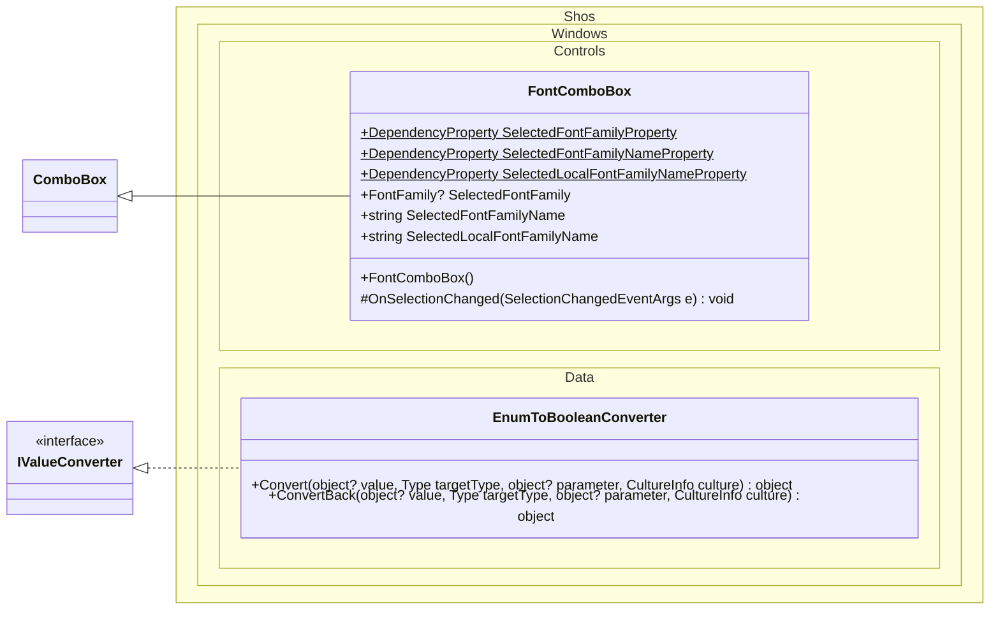

# Shos.Windows

[English](https://github.com/Fujiwo/Shos.Windows/blob/master/README.md) | 日本語

[](https://github.com/Fujiwo/Shos.Windows/actions/workflows/build.yml)
[](https://www.nuget.org/packages/Shos.Windows)
[](https://github.com/Fujiwo/Shos.Windows/blob/master/license)

.NET 8.0 および .NET 10.0 向けの小さな WPF ライブラリです。

- [FontComboBox](#fontcombobox): システムのフォント ファミリーから 1 つを選択するコンボ ボックス
- [EnumToBooleanConverter](#enumtobooleanconverter): 複数のラジオ ボタンを 1 つの列挙型プロパティにバインドするためのコンバーター

## インストール

NuGet からインストールできます: [NuGet Gallery | Shos.Windows](https://www.nuget.org/packages/Shos.Windows "NuGet Gallery | Shos.Windows")

```
dotnet add package Shos.Windows
```

### 動作要件

- .NET 8.0 (`net8.0-windows`) または .NET 10.0 (`net10.0-windows`)
- WPF (`<UseWPF>true</UseWPF>`)

## クラス図

Shos.Windows の公開されている型とメンバーです (`+`: public、`#`: protected、下線: static)。
`ComboBox` (`System.Windows.Controls`) と `IValueConverter` (`System.Windows.Data`) は WPF の型です。



## コントロール

### FontComboBox

名前空間: `Shos.Windows.Controls`

[System.Windows.Controls.ComboBox](https://learn.microsoft.com/dotnet/api/system.windows.controls.combobox?view=windowsdesktop-8.0) の派生クラスです。

システムのフォント ファミリーから 1 つを選択するコンボ ボックスです。

- 各項目はそのフォント自身で描画されます。記号フォント (Marlett、Wingdings など) は名前が読めるように既定のフォントで描画されます。
- 項目は (現在のカルチャでの) ローカライズされた名前で表示され、その名前順に並びます。名前をキー入力すると、一致する項目が選択されます。
- 項目は仮想化されているため、多数のフォントがインストールされていてもドロップダウンがすばやく開きます。
- フォントの一覧は一度だけ作成され、すべてのインスタンスで共有されます。

#### プロパティ

次のプロパティは互いに、また `SelectedItem` と同期しており、既定で双方向 (TwoWay) バインドになります。
名前は大文字と小文字を区別せずに比較されます。
どのシステム フォントにも一致しない値を設定すると、選択が解除されます (`SelectedFontFamily` は `null`、名前のプロパティは `""` になります)。

| プロパティ | 型 | 既定値 | 説明 |
|---|---|---|---|
| SelectedFontFamily | FontFamily? | `SystemFonts.MenuFontFamily` | 選択されているフォント ファミリー。 |
| SelectedFontFamilyName | string | 既定のフォント ファミリーの名前 | 選択されているフォント ファミリーの名前 (`FontFamily.Source`)。例: `"Yu Gothic UI"` |
| SelectedLocalFontFamilyName | string | 既定のフォント ファミリーのローカライズされた名前 | 選択されているフォント ファミリーの (現在のカルチャでの) ローカライズされた名前。例: `"游ゴシック UI"` |

#### 使用例

```xml
<Window xmlns:shoswindowscontrols="clr-namespace:Shos.Windows.Controls;assembly=Shos.Windows" ...>
    <StackPanel>
        <shoswindowscontrols:FontComboBox SelectedFontFamilyName="{Binding SelectedFontFamilyName}" />
        <TextBox FontFamily="{Binding SelectedFontFamilyName}" />
    </StackPanel>
</Window>
```

`FontFamily` オブジェクトを直接バインドすることもできます:

```xml
<shoswindowscontrols:FontComboBox x:Name="fontComboBox" />
<TextBox FontFamily="{Binding SelectedFontFamily, ElementName=fontComboBox}" />
```

## コンバーター

### EnumToBooleanConverter

名前空間: `Shos.Windows.Data`

[System.Windows.Data.IValueConverter](https://learn.microsoft.com/dotnet/api/system.windows.data.ivalueconverter?view=windowsdesktop-8.0) を実装しています。

複数のラジオ ボタンを 1 つの列挙型プロパティにバインドするために使います。

- `Convert`: 列挙値がコンバーター パラメーターと等しければ `true`、そうでなければ `false` を返します。
- `ConvertBack`: 値が `true` のときはコンバーター パラメーターを返します。それ以外のとき (ラジオ ボタンのチェックが外れたときなど) はソースを更新しません (`Binding.DoNothing`)。

コンバーター パラメーターには次のどちらも指定できます:

- 列挙値そのもの (例: `ConverterParameter={x:Static local:FontSizeKind.Small}`)
- 列挙型のメンバー名 (例: `ConverterParameter=Small`)

null 許容の列挙型プロパティ (例: `FontSizeKind?`) にも対応しています。
値が列挙型でない場合や、パラメーターが列挙型に一致しない場合、`Convert` は `DependencyProperty.UnsetValue` を返します。

#### 使用例

```csharp
public enum FontSizeKind { Small, Medium, Large }
```

```xml
<Window xmlns:shoswindowsdata="clr-namespace:Shos.Windows.Data;assembly=Shos.Windows"
        xmlns:local="clr-namespace:YourApp" ...>
    <Window.Resources>
        <shoswindowsdata:EnumToBooleanConverter x:Key="enumToBooleanConverter" />
    </Window.Resources>
    <StackPanel>
        <RadioButton Content="Small"  IsChecked="{Binding FontSizeKind, Converter={StaticResource enumToBooleanConverter}, ConverterParameter={x:Static local:FontSizeKind.Small}}" />
        <RadioButton Content="Medium" IsChecked="{Binding FontSizeKind, Converter={StaticResource enumToBooleanConverter}, ConverterParameter={x:Static local:FontSizeKind.Medium}}" />
        <RadioButton Content="Large"  IsChecked="{Binding FontSizeKind, Converter={StaticResource enumToBooleanConverter}, ConverterParameter={x:Static local:FontSizeKind.Large}}" />
    </StackPanel>
</Window>
```

## プロジェクト

| プロジェクト | 説明 |
|---|---|
| Shos.Windows | ライブラリ本体 (名前空間: `Shos.Windows.Controls`、`Shos.Windows.Data`) |
| Shos.Windows.Sample | Shos.Windows を使った WPF のサンプル アプリ |
| Shos.Windows.Tests | 単体テスト (xUnit) |

## ソースからのビルド

Windows と .NET 10.0 SDK が必要です (`net8.0-windows` のテストを実行するには .NET 8.0 ランタイムも必要です)。

```
git clone https://github.com/Fujiwo/Shos.Windows.git
cd Shos.Windows
dotnet build Shos.Windows.sln --configuration Release
dotnet test Shos.Windows.sln --configuration Release --no-build
```

NuGet パッケージ (`net8.0-windows` と `net10.0-windows` の両方のアセンブリを含む) は `Shos.Windows/bin/Release/` に生成されます。

## 作者

小島 富治雄: 日本のソフトウェア開発者
* Microsoft MVP for Development Tools - Visual C# (2005年7月 - 2014年12月)
* Microsoft MVP for .NET (2015年1月 - 2015年10月)
* Microsoft MVP for Visual Studio and Development Technologies (2015年11月 - 2018年6月)
* Microsoft MVP for Developer Technologies (2018年11月 - 2027年6月)
* [MVP プロフィール](https://mvp.microsoft.com/ja-jp/PublicProfile/21482 "MVP プロフィール")
* [ブログ](https://wp.shos.info "ブログ")
* [Web サイト](https://www.shos.info "Web サイト")

## ライセンス

このライブラリは [MIT ライセンス](https://github.com/Fujiwo/Shos.Windows/blob/master/license) で提供されています。
