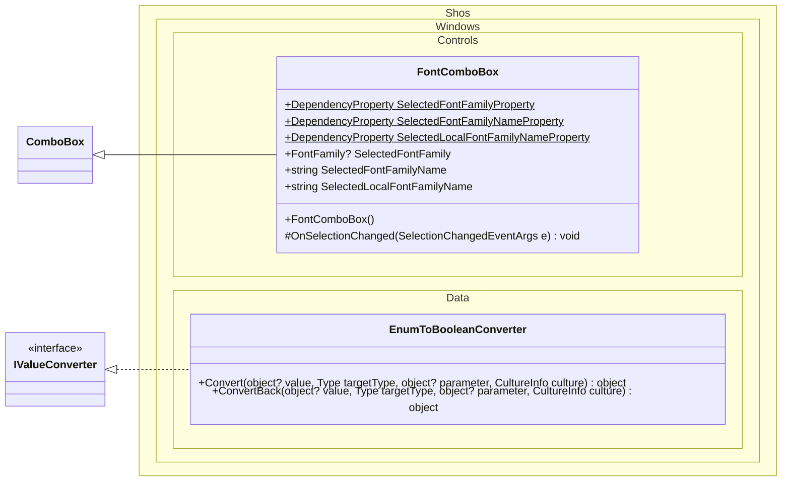

# Shos.Windows

[](https://github.com/Fujiwo/Shos.Windows/actions/workflows/build.yml)
[](https://www.nuget.org/packages/Shos.Windows)
[](https://github.com/Fujiwo/Shos.Windows/blob/master/license)

A small WPF library for .NET 8.0 and .NET 10.0.

- [FontComboBox](#fontcombobox): a combo box to select one of the system font families
- [EnumToBooleanConverter](#enumtobooleanconverter): a converter to bind multiple radio buttons to a single enum property

## Installation

Install from NuGet: [NuGet Gallery | Shos.Windows](https://www.nuget.org/packages/Shos.Windows "NuGet Gallery | Shos.Windows")

```
dotnet add package Shos.Windows
```

### Requirements

- .NET 8.0 (`net8.0-windows`) or .NET 10.0 (`net10.0-windows`)
- WPF (`<UseWPF>true</UseWPF>`)

## Class Diagram

The public types and members of Shos.Windows (`+`: public, `#`: protected, underlined: static).
`ComboBox` (`System.Windows.Controls`) and `IValueConverter` (`System.Windows.Data`) are WPF types.



## Controls

### FontComboBox

Namespace: `Shos.Windows.Controls`

Derives from [System.Windows.Controls.ComboBox](https://learn.microsoft.com/dotnet/api/system.windows.controls.combobox?view=windowsdesktop-8.0).

A combo box to select one of the system font families.

- Each item is drawn with its own font. Symbol fonts (e.g. Marlett, Wingdings) are drawn with the default font so that their names stay readable.
- Items are shown by their localized names (for the current culture) and sorted by them. Typing a name selects the matching item.
- Items are virtualized, so the drop-down opens quickly even when many fonts are installed.
- The font list is built once and shared by all instances.

#### Properties

The following properties are kept synchronized with each other and with `SelectedItem`, and bind two-way by default.
Names are compared case-insensitively.
When a value that matches no system font is set, the selection is cleared (`SelectedFontFamily` becomes `null`, and the name properties become `""`).

| Property | Type | Default | Description |
|---|---|---|---|
| SelectedFontFamily | FontFamily? | `SystemFonts.MenuFontFamily` | The selected font family. |
| SelectedFontFamilyName | string | Name of the default font family | The name (`FontFamily.Source`) of the selected font family. e.g. `"Yu Gothic UI"` |
| SelectedLocalFontFamilyName | string | Localized name of the default font family | The localized name (for the current culture) of the selected font family. e.g. `"游ゴシック UI"` |

#### Example

```xml
<Window xmlns:shoswindowscontrols="clr-namespace:Shos.Windows.Controls;assembly=Shos.Windows" ...>
    <StackPanel>
        <shoswindowscontrols:FontComboBox SelectedFontFamilyName="{Binding SelectedFontFamilyName}" />
        <TextBox FontFamily="{Binding SelectedFontFamilyName}" />
    </StackPanel>
</Window>
```

You can also bind the `FontFamily` object directly:

```xml
<shoswindowscontrols:FontComboBox x:Name="fontComboBox" />
<TextBox FontFamily="{Binding SelectedFontFamily, ElementName=fontComboBox}" />
```

## Converters

### EnumToBooleanConverter

Namespace: `Shos.Windows.Data`

Implements [System.Windows.Data.IValueConverter](https://learn.microsoft.com/dotnet/api/system.windows.data.ivalueconverter?view=windowsdesktop-8.0).

Used to bind multiple radio buttons to a single enum property.

- `Convert`: returns `true` when the enum value equals the converter parameter, otherwise `false`.
- `ConvertBack`: returns the converter parameter when the value is `true`. Otherwise (e.g. when a radio button is unchecked) the source is not updated (`Binding.DoNothing`).

The converter parameter can be either:

- the enum value itself (e.g. `ConverterParameter={x:Static local:FontSizeKind.Small}`), or
- the name of an enum member (e.g. `ConverterParameter=Small`).

Nullable enum properties (e.g. `FontSizeKind?`) are also supported.
When the value is not an enum or the parameter does not match the enum type, `Convert` returns `DependencyProperty.UnsetValue`.

#### Example

```csharp
public enum FontSizeKind { Small, Medium, Large }
```

```xml
<Window xmlns:shoswindowsdata="clr-namespace:Shos.Windows.Data;assembly=Shos.Windows"
        xmlns:local="clr-namespace:YourApp" ...>
    <Window.Resources>
        <shoswindowsdata:EnumToBooleanConverter x:Key="enumToBooleanConverter" />
    </Window.Resources>
    <StackPanel>
        <RadioButton Content="Small"  IsChecked="{Binding FontSizeKind, Converter={StaticResource enumToBooleanConverter}, ConverterParameter={x:Static local:FontSizeKind.Small}}" />
        <RadioButton Content="Medium" IsChecked="{Binding FontSizeKind, Converter={StaticResource enumToBooleanConverter}, ConverterParameter={x:Static local:FontSizeKind.Medium}}" />
        <RadioButton Content="Large"  IsChecked="{Binding FontSizeKind, Converter={StaticResource enumToBooleanConverter}, ConverterParameter={x:Static local:FontSizeKind.Large}}" />
    </StackPanel>
</Window>
```

## Projects

| Project | Description |
|---|---|
| Shos.Windows | The library (namespaces: `Shos.Windows.Controls`, `Shos.Windows.Data`) |
| Shos.Windows.Sample | A WPF sample app using Shos.Windows |
| Shos.Windows.Tests | Unit tests (xUnit) |

## Building from Source

Requires Windows and the .NET 10.0 SDK (plus the .NET 8.0 runtime to run the tests for `net8.0-windows`).

```
git clone https://github.com/Fujiwo/Shos.Windows.git
cd Shos.Windows
dotnet build Shos.Windows.sln --configuration Release
dotnet test Shos.Windows.sln --configuration Release --no-build
```

The NuGet package (containing both `net8.0-windows` and `net10.0-windows` assemblies) is generated in `Shos.Windows/bin/Release/`.

## Author Info

Fujio Kojima: a software developer in Japan
* Microsoft MVP for Development Tools - Visual C# (Jul. 2005 - Dec. 2014)
* Microsoft MVP for .NET (Jan. 2015 - Oct. 2015)
* Microsoft MVP for Visual Studio and Development Technologies (Nov. 2015 - Jun. 2018)
* Microsoft MVP for Developer Technologies (Nov. 2018 - Jun. 2027)
* [MVP Profile](https://mvp.microsoft.com/en-us/PublicProfile/21482 "MVP Profile")
* [Blog (Japanese)](https://wp.shos.info "Blog (Japanese)")
* [Web Site (Japanese)](https://www.shos.info "Web Site (Japanese)")

## License

This library is under the [MIT License](https://github.com/Fujiwo/Shos.Windows/blob/master/license).
